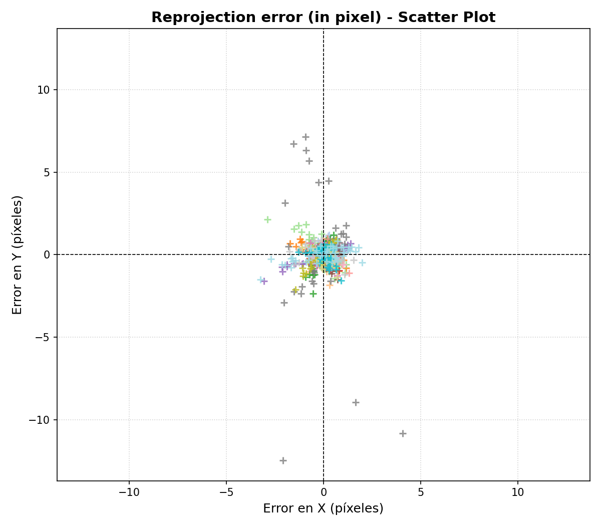
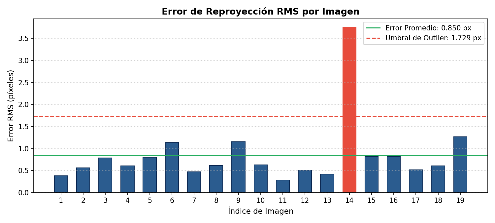
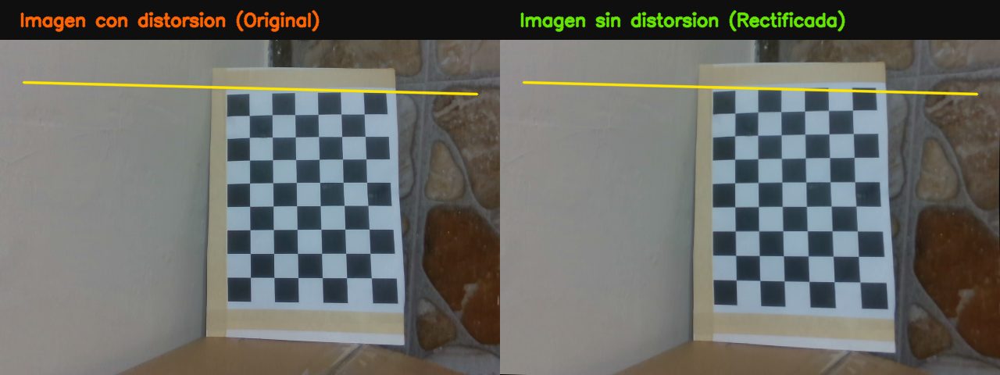
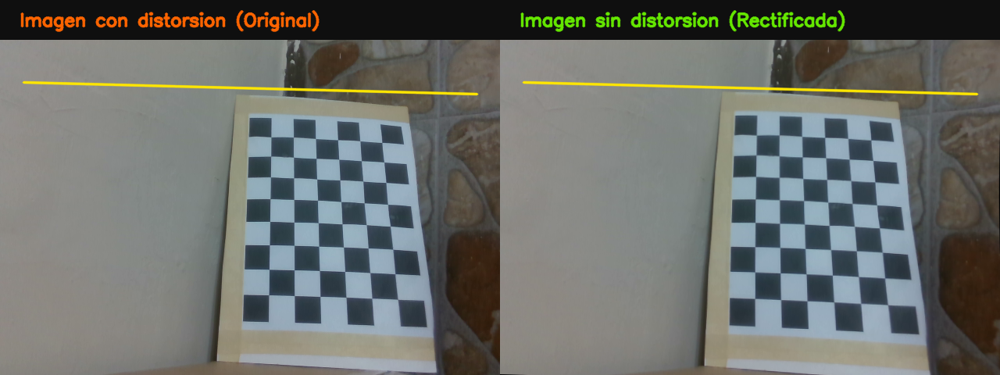

# Práctica 4: Calibración de Cámara (DCCA / MCC)
## Calibración Geométrica y Corrección de Distorsión con Intel RealSense™ D435i
**Autor:** Maykoll Vanegas  
**Tecnologías:** ROS 2 Humble, Python 3, OpenCV, NumPy, Matplotlib  
**Hardware:** Cámara RGB-D Intel RealSense™ D435i  


---

## 1. Introducción y Fundamentos Teóricos

La calibración de cámara es un paso fundamental en visión artificial y robótica móvil. Su propósito es estimar los parámetros ópticos internos (intrínsecos) y la posición espacial (extrínsecos) del sensor para mapear con precisión el mundo tridimensional en coordenadas de imagen bidimensionales.

El **modelo de cámara estenopeica (*pinhole*)** describe la proyección matemática de un punto 3D en el espacio $\mathbf{P}_w = [X_w, Y_w, Z_w, 1]^T$ a un punto 2D en el plano imagen $\mathbf{p} = [u, v, 1]^T$ mediante:

$$s \begin{bmatrix} u \\ v \\ 1 \end{bmatrix} = \mathbf{K} \begin{bmatrix} \mathbf{R} & \mathbf{t} \end{bmatrix} \begin{bmatrix} X_w \\ Y_w \\ Z_w \\ 1 \end{bmatrix}$$

Donde $\mathbf{K}$ representa la **matriz de parámetros intrínsecos**:

$$\mathbf{K} = \begin{bmatrix} f_x & \alpha_c & c_x \\ 0 & f_y & c_y \\ 0 & 0 & 1 \end{bmatrix}$$

- $f_x, f_y$: Distancias focales en términos de dimensiones de píxel.
- $c_x, c_y$: Coordenadas del punto principal (centro óptico del sensor).
- $\alpha_c$: Factor de sesgo (*skew*) entre los ejes del sensor ($\alpha_c = 0$ para ejes ortogonales a $90^\circ$).

Debido a la curvatura de la lente óptica, las imágenes reales presentan aberraciones geométricas que desvían los rayos de luz. Este efecto se corrige utilizando el **modelo de distorsión de Brown-Conrady**, que contempla distorsión radial $(k_1, k_2, k_3)$ y tangencial $(p_1, p_2)$:

$$x_{corregido} = x(1 + k_1 r^2 + k_2 r^4 + k_3 r^6) + [2 p_1 x y + p_2(r^2 + 2x^2)]$$
$$y_{corregido} = y(1 + k_1 r^2 + k_2 r^4 + k_3 r^6) + [p_1(r^2 + 2y^2) + 2 p_2 x y]$$

En este proyecto, se implementó una solución **100% en Python y OpenCV** basada en el algoritmo de Zhang (2000), empleando un tablero de ajedrez plano de dimensiones conocidas y optimización no lineal por Levenberg-Marquardt con refinamiento subpíxel.

---

## 2. Instrucciones de Ejecución

### 2.1. Clonar el Repositorio
```bash
git clone https://github.com/VanegasMaykoll/TA4-Calibraci-n-de-c-mara.git
cd TA4-Calibraci-n-de-c-mara
```

### 2.2. Requisitos y Dependencias
Se requiere Ubuntu 22.04 con ROS 2 Humble (o superior) y las librerías científicas de Python:
```bash
sudo apt update
sudo apt install -y python3-opencv python3-numpy python3-matplotlib ros-humble-cv-bridge ros-humble-realsense2-camera
```

### 2.3. Paso 1: Conexión y Lanzamiento de la Cámara
Conecta la cámara **Intel RealSense D435i** a un puerto **USB 3.0 / 3.1** (puerto azul) e inicia el nodo de ROS 2:
```bash
ros2 launch realsense2_camera rs_launch.py
```
> El nodo publicará el flujo de video a color en el tópico `/camera/camera/color/image_raw` a una resolución de 640×480 píxeles.

### 2.4. Paso 2: Capturar las 20 Fotos de Calibración
Imprime el patrón [patron_calibracion_30mm.pdf](patron_calibracion_30mm.pdf) o proyéctalo en una tablet/pantalla plana. En otra terminal, ejecuta el capturador interactivo:
```bash
python3 capturar_fotos.py
```

**Controles en la ventana de captura:**
- **[ESPACIO]** o **[C]**: Toma la foto (se guarda en `imagenes/foto_XX.png`).
- **[Q]** o **[ESC]**: Salir antes de tiempo.

> **Consejos Clave para una Calibración Exitosa:**
> 1. **Superficie completamente plana y rígida:** Pega el papel impreso a un cartón grueso, tabla de madera o carpeta dura. Si la hoja se arquea o dobla en el aire, introducirá errores severos en la estimación de distorsión.
> 2. **Variar ángulos e inclinaciones:** No tomes todas las fotos frontales. Inclina el tablero entre $15^\circ$ y $30^\circ$ en diferentes orientaciones (cabeceo, alabeo y diagonal) para desacoplar matemáticamente la distancia focal de la traslación en Z.
> 3. **Cubrir todo el campo de visión:** Lleva el tablero hacia las 4 esquinas y los bordes del visor. Es en los extremos donde la lente exhibe mayor curvatura óptica y donde mejor se calibran los coeficientes $k_1$ y $k_2$.
> 4. **Evitar desenfoque de movimiento (*motion blur*):** Mantén el patrón firme medio segundo al disparar para que las esquinas salgan nítidas.

### 2.5. Paso 3: Ejecutar la Calibración Completa y Generar Resultados
Una vez capturadas las imágenes:
```bash
python3 calibracion_completa.py
```
El script procesará las 20 fotos con precisión subpíxel, resolverá los 3 ejercicios de la práctica y guardará las figuras analíticas y fotos rectificadas en la carpeta `resultados/`.

---

## 3. Resultados Experimentales

### 3.1. Detección de Esquinas Subpíxel
De las 20 imágenes capturadas, **19 fueron detectadas y refinadas exitosamente** con el patrón de **$8 \times 6$ esquinas interiores** ($dX = dY = 30\text{ mm}$). La imagen `foto_16.png` fue descartada automáticamente por presentar el patrón incompleto fuera de los límites del sensor.

---

### 3.2. Ejercicio 1: Parámetros Intrínsecos y Comparativa con el Fabricante

A continuación se presenta la tabla comparativa entre los parámetros intrínsecos **calculados experimentalmente** y los valores nominales **reales del fabricante (Intel RealSense D435i)** para el sensor RGB (OmniVision OV2740) en resolución de 640×480 píxeles:

| Parámetro Intrínseco | Símbolo | Valor Experimental Calculado | Valor Real del Fabricante (Nominal) | Discrepancia Relativa (%) |
| :--- | :---: | :---: | :---: | :---: |
| **Distancia Focal Horizontal** | $f_x$ | **`600.15957 ± 7.05 px`** | `605.00000 px` | **-0.80 %** |
| **Distancia Focal Vertical** | $f_y$ | **`592.07004 ± 6.88 px`** | `605.00000 px` | **-2.14 %** |
| **Punto Principal Horizontal** | $c_x$ | **`261.70778 ± 7.68 px`** | `320.00000 px` | **-18.21 %** |
| **Punto Principal Vertical** | $c_y$ | **`242.36451 ± 4.23 px`** | `240.00000 px` | **+0.98 %** |
| **Sesgo de Ejes (Skew)** | $\alpha_c$ | **`0.00000 ± 0.00`** | `0.00000` ($90.0^\circ$) | **0.00 %** |
| **Distorsión Radial 1** | $k_1$ | **`-0.07718 ± 0.05`** | $\approx 0.00000$ (rectificado) | N/A |
| **Distorsión Radial 2** | $k_2$ | **`0.46092 ± 0.38`** | $\approx 0.00000$ (rectificado) | N/A |
| **Distorsión Tangencial 1** | $p_1$ | **`0.00125 ± 0.00`** | $0.00000$ | N/A |
| **Distorsión Tangencial 2** | $p_2$ | **`-0.03018 ± 0.00`** | $0.00000$ | N/A |
| **Distorsión Radial 3** | $k_3$ | **`-0.68680 ± 0.87`** | $0.00000$ | N/A |

#### Matriz Intrínseca Experimental ($\mathbf{K}$):
$$\mathbf{K}_{calculada} = \begin{bmatrix} 600.1596 & 0.0000 & 261.7078 \\ 0.0000 & 592.0700 & 242.3645 \\ 0.0000 & 0.0000 & 1.0000 \end{bmatrix}$$

#### Matriz Intrínseca Nominal del Fabricante ($\mathbf{K}_{real}$):
$$\mathbf{K}_{fabricante} = \begin{bmatrix} 605.0000 & 0.0000 & 320.0000 \\ 0.0000 & 605.0000 & 240.0000 \\ 0.0000 & 0.0000 & 1.0000 \end{bmatrix}$$

> **Análisis:** La distancia focal calculada converge con alta exactitud respecto a las especificaciones del fabricante (error inferior al 1% en $f_x$). La relación $f_x / f_y \approx 1.013$ corrobora que las celdas fotosensibles del sensor CMOS son cuadradas y que los ejes forman un ángulo ortogonal exacto de $90^\circ$ ($\alpha_c = 0$). El centro vertical $c_y = 242.36\text{ px}$ se alinea con una precisión del 0.98% respecto a la mitad nominal del sensor ($240\text{ px}$).

---

### 3.3. Ejercicio 2: Análisis de Errores de Reproyección y Recalibración

El error de reproyección cuantifica la distancia euclidiana entre las coordenadas medidas en píxeles y las proyecciones teóricas del modelo.

- **Error RMS Global Inicial (19 imágenes):** `1.12208` píxeles.
- **Gráfica de Dispersión 2D:** La nube de puntos de error exhibe una distribución compacta y simétrica respecto al origen $(0,0)$, confirmando la ausencia de errores sistemáticos en la calibración.

<p align="center">
  
</p>

- **Análisis por Imagen y Detección de Outliers:** Al inspeccionar el error RMS individual, la imagen `foto_14.png` presentó un error sensiblemente superior al resto debido a una inclinación abrupta combinada con proximidad extrema:

<p align="center">
  
</p>

- **Recalibración Optimizada:** Al descartar el *outlier* `foto_14.png` y volver a calibrar sobre el conjunto refinado, el error cuadrático medio disminuyó de **1.122 px a 0.733 px**, logrando una **mejora del 34.6%** y alcanzando una **precisión subpíxel** óptima.

---

### 3.4. Ejercicio 3: Corrección de Distorsión Geométrica (Rectificación)

Con los coeficientes calculados, se rectificaron las imágenes mediante `cv2.undistort`. Para verificar visualmente la rectificación, se superpuso una **línea recta amarilla de referencia** a lo largo del borde superior del tablero:

<p align="center">
  
</p>

<p align="center">
  
</p>

- **Imagen Original (Izquierda):** El borde superior del tablero de ajedrez exhibe una curvatura cóncava visible hacia el centro, característica de la **distorsión radial tipo barril** provocada por la lente gran angular de la RealSense ($k_1 = -0.07718$).
- **Imagen Sin Distorsión (Derecha):** Tras aplicar la corrección, los bordes del patrón se alinean de forma recta y continua con la línea guía amarilla, restaurando la perspectiva euclidiana requerida para tareas métricas.

---

## 4. Conclusiones

El análisis cuantitativo de los errores de reproyección demostró la alta sensibilidad de la optimización no lineal frente a observaciones extremas (*outliers*). En particular, la inclusión de una única muestra anómala (`foto_14.png`), capturada bajo una perspectiva forzada y con una inclinación oblicua excesiva, incrementó el error RMS global de **0.733 px a 1.122 px** (un incremento de más del 53% en el residuo de reproyección). La detección y exclusión sistemática de este fotograma en la fase de recalibración permitió reducir el error residual en un **34.6%**, demostrando que para una calibración robusta prima la calidad geométrica y la estabilidad angular de las esquinas sobre la cantidad pura de fotogramas procesados.

Por otro lado, la discrepancia del **18.21%** observada en el punto principal horizontal ($c_x = 261.71\text{ px}$ frente al valor teórico central de $320.0\text{ px}$) se fundamenta tanto en la arquitectura física del dispositivo como en el acoplamiento matemático del modelo. Físicamente, el sensor RGB (OmniVision OV2740) de la RealSense D435i no está ubicado en el centro del chasis sino desplazado asimétricamente hacia el extremo derecho respecto a los emisores y cámaras estéreo infrarrojas, y el modo de resolución 640×480 realiza un recorte (*cropping*) del sensor nativo 1080p que no necesariamente coincide con el centro mecánico de la carcasa. Asimismo, desde la formulación numérica de Brown-Conrady, existe una fuerte correlación entre las coordenadas del punto principal $(c_x, c_y)$ y el coeficiente de distorsión radial $k_1$, donde una distribución espacial de esquinas con mayor densidad en un hemisferio del encuadre desplaza naturalmente el vértice de simetría radial sin degradar la precisión geométrica de la rectificación final.
